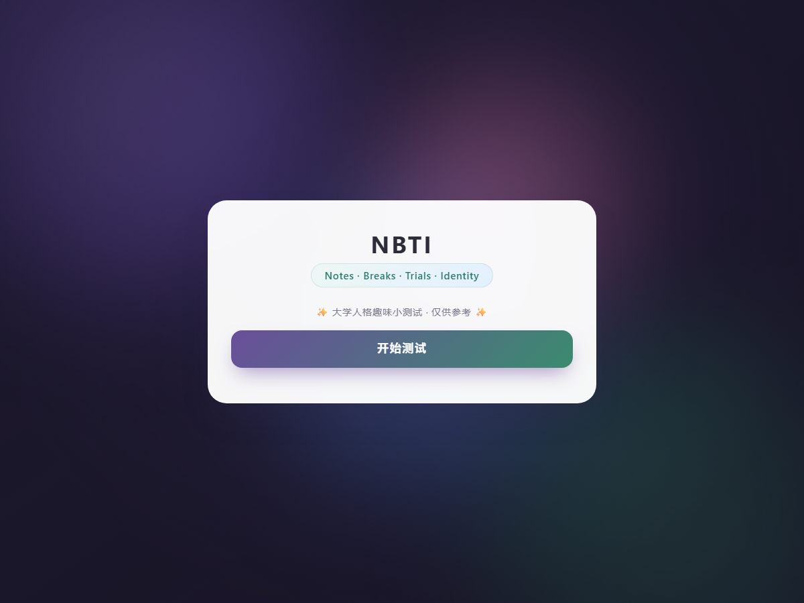
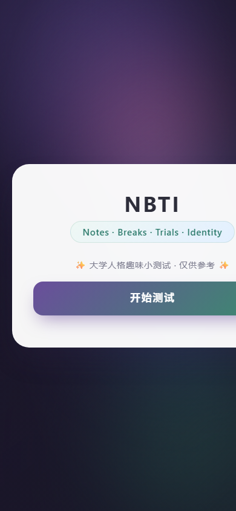

<div align="center">

# NBTI · 大学人格趣味测试

**一个零依赖的单文件 H5 人格测试 —— 打开即玩，无需安装任何东西**

[](https://astlibraanulis.github.io/nbti/)


[**▶ 立即体验**](https://astlibraanulis.github.io/nbti/) · [查看源码](./nbti.html)

</div>

---

## 预览

<div align="center">
  
  <p><sub>桌面端</sub></p>
  
  <p><sub>移动端适配</sub></p>
</div>

---

## 这是什么

NBTI（**N**otes · **B**reaks · **T**rials · **I**dentity）是一个面向大学生的趣味人格测试。

用户通过一组单选题作答，系统实时记录进度，最终根据得分分布给出一个**人格类型结果**，并附上对应的性格描述。整体定位是"轻松的自我观察小工具"，结果仅供娱乐参考。

## 功能特性

- **完整答题流程** —— 欢迎页 → 逐题作答 → 自动计分 → 结果页
- **实时进度反馈** —— 顶部进度条 + 题号提示，随时知道还剩多少
- **多维度计分** —— 答案按维度累加，最后映射到人格类型
- **结果页展示** —— 类型名称、形象图标、性格描述
- **可回退** —— 答题过程中可返回上一题修改选择
- **响应式布局** —— 桌面端与移动端均按屏幕宽度自适应
- **零依赖零构建** —— 所有样式与逻辑内联在单个 HTML 文件中

## 技术说明

| 项 | 说明 |
|---|---|
| 技术栈 | 原生 HTML5 + CSS3 + JavaScript（ES6） |
| 依赖 | **无**，不使用任何框架、CDN 或第三方库 |
| 构建 | **无**，不需要 npm / webpack / vite |
| 部署 | 直接放在任意静态服务器或 GitHub Pages |
| 兼容性 | 现代浏览器（Chrome / Edge / Safari / Firefox） |

之所以选择单文件形态：这个项目的目标是"发一个链接或一个文件就能用"。
不引入框架意味着没有安装步骤、没有版本冲突，评审者双击文件即可运行。

## 目录结构

```
nbti/
├── index.html            # 页面入口（GitHub Pages 默认加载）
├── nbti.html             # 原始单文件源码（与 index.html 内容一致）
├── images/               # README 预览图
│   ├── preview.png
│   └── preview-mobile.png
├── LICENSE
└── README.md
```

> `index.html` 与 `nbti.html` 内容一致，前者是为了让 GitHub Pages 在根路径直接展示页面。

## 本地运行

方式一：双击 `index.html`，浏览器直接打开。

方式二：起一个静态服务器（更接近线上环境）：

```bash
cd nbti
python -m http.server 8000
# 然后访问 http://localhost:8000
```

## 设计思路

- **低门槛**：欢迎页只保留一句话说明和一个开始按钮，减少进入成本
- **节奏感**：每题作答后即时进入下一题，配合进度条制造推进感
- **克制的视觉**：深色渐变背景 + 单张白卡，颜色只用于按钮和强调，避免干扰阅读
- **不评判**：结果页只做描述，不做优劣判断

## 免责声明

本项目为课程作业，测试结果基于预设计分规则生成，**不具备任何心理学诊断效度**，仅供娱乐。

## License

[MIT](./LICENSE) © 2026 ASTLIBRAanulis