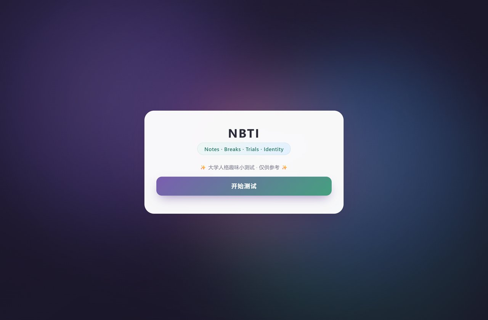

<div align="center">

# NBTI · 大学人格趣味测试

**一个零依赖的单文件 H5 人格测试 —— 打开即玩，无需安装任何东西**

[](https://astlibraanulis.github.io/nbti/)


[**▶ 立即体验**](https://astlibraanulis.github.io/nbti/) · [查看源码](./nbti.html)

</div>

---

## 使用流程

<table>
  <tr>
    <td align="center"><br /><sub><b>① 欢迎页</b><br />一句话说明 + 开始按钮</sub></td>
    <td align="center"><br /><sub><b>② 答题页</b><br />进度条 + 第 N / 20 题</sub></td>
    <td align="center"><br /><sub><b>③ 结果页</b><br />人格类型 + 描述</sub></td>
  </tr>
</table>

<p align="center">
  
  <br /><sub>移动端自适应</sub>
</p>

---

## 这是什么

NBTI（**N**otes · **B**reaks · **T**rials · **I**dentity）是一个面向大学生的趣味人格测试。

用户依次完成 **20 道**与校园生活相关的情景单选题（选课、室友、小组作业、期末周……），每选一项都会累加对应维度的分数，最终映射到一种人格类型（如 `SUNNY · 氛围小太阳`），并给出对应的人格描述。

定位是"轻松的自我观察小工具"——**结果仅供娱乐参考，不具备心理学诊断效度**。

## 功能特性

| 功能 | 说明 |
|---|---|
| 完整答题流程 | 欢迎页 → 逐题作答 → 自动计分 → 结果页 |
| 实时进度 | 顶部进度条 + `第 N / 20 题` 题号提示 |
| 单题四选一 | 每个情景四个选项，点击即进入下一题 |
| 可回退修改 | 「← 返回上一题」随时改上一题的选择 |
| 结果可视 | 类型代号 + 中文昵称 + 表情图标 + 长文描述 |
| 一键重测 | 结果页「再测一次」直接回到起点 |
| 响应式 | 桌面端与移动端按屏幕宽度自适应 |
| 零依赖 | 不加载任何框架、字体或 CDN 资源，断网也能用 |

## 技术说明

| 项 | 说明 |
|---|---|
| 技术栈 | 原生 HTML5 + CSS3 + JavaScript（ES6） |
| 依赖 | **无**，不使用任何框架、CDN 或第三方库 |
| 构建 | **无**，不需要 npm / webpack / vite |
| 体积 | 单个 HTML 文件，约 42 KB |
| 部署 | 任意静态服务器，或 GitHub Pages（本项目已启用） |
| 兼容性 | 现代浏览器（Chrome / Edge / Safari / Firefox） |

**为什么是单文件**：这个项目的目标是"发一个链接或一个文件就能用"。不引入框架意味着没有安装步骤、没有版本冲突，评审者双击 `index.html` 就能运行，放在手机上离线也能打开。

实现上用原生 DOM 操作维护"当前题号 / 各维度得分"两个状态，每次作答后重渲染题目区域与进度条，无需任何路由或状态管理库。

## 目录结构

```
nbti/
├── index.html            # 页面入口（GitHub Pages 默认加载）
├── nbti.html             # 原始单文件源码（与 index.html 内容一致）
├── images/               # README 配图
│   ├── step-1-welcome.jpg
│   ├── step-2-quiz.jpg
│   ├── step-3-result.jpg
│   └── preview-mobile.png
├── LICENSE
└── README.md
```

> `index.html` 与 `nbti.html` 内容一致，前者是为了让 GitHub Pages 在根路径直接展示页面。

## 本地运行

方式一：双击 `index.html`，浏览器直接打开。

方式二：起一个静态服务器（更接近线上环境）：

```bash
cd nbti
python -m http.server 8000
# 访问 http://localhost:8000
```

## 设计思路

- **低门槛**：欢迎页只保留一句话说明和一个开始按钮，减少进入成本
- **节奏感**：作答后即时进入下一题，配合进度条制造推进感
- **克制的视觉**：深色渐变背景 + 单张白卡，颜色只用于按钮与强调色，避免干扰阅读
- **不评判**：结果页只做描述，不给优劣判断，也不引导分享炫耀

## 免责声明

本项目为课程作业，测试结果基于预设计分规则生成，**不构成任何心理学评估或诊断**，仅供娱乐。

## License

[MIT](./LICENSE) © 2026 ASTLIBRAanulis